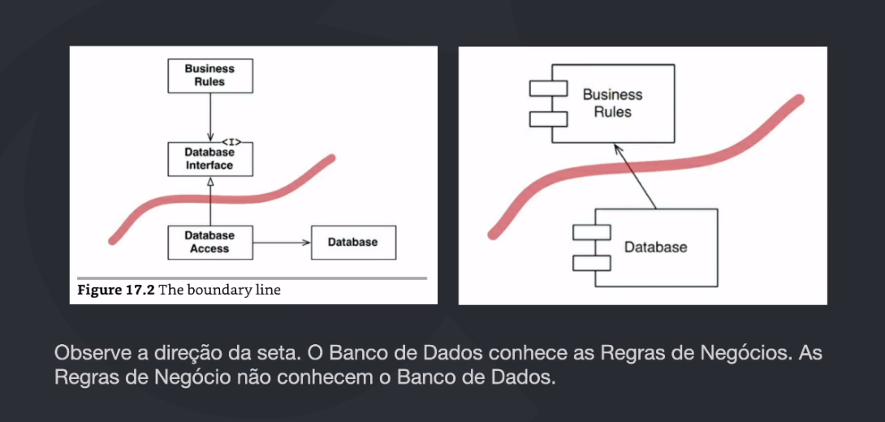
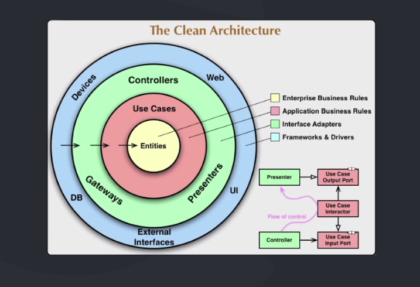

# Clean Architecture

- Termo criado por robert C. Martin (Uncle Bob) em 2012;
- Proteção do domínio da aplicação
  - Variação da arquitetura hexagonal
- Baixo acoplamento entre camadas
  - Camadas = Limites arquiteturais
  - Comunicação via contratos (interfaces)
- Orientada a casos de uso
  - Casos de uso = Intenção do usuário fazer alguma ação
  - Conseguimos saber qual a intenção do sistema
 
*Curiosidade sobre o livro*
1. Temas específicos do Clean Architecture são abordados em apenas 7 páginas do livro;
2. Tudo que é abordado sobre Clean Architecture está LITERALMENTE no blog do Uncle Bob.

---

## Pontos IMPORTANTES de arquitetura

- A arquitetura define o **FORMATO** que o software terá;
- **Divisão** clara dos componentes;
- Comunicação entre componentes;
- Uma boa arquitetura vai facilitar no processo de desenvolvimento;

> *"A estratégia por trás da facilitação é deixar o máximo de opções possíveis para agregar e imcorporar funcionalidades no software."*

---

## Objetivo de um boa arquitetura

- Objetivo principal é dar suporte ao ciclo de vida do software;
- Facilidade de manutenção;
- Facilidade de evolução;
- Facilidade de escalabilidade;
- Facilidade de testabilidade;
- Facilidade de reuso de código;
- Facilidade de compartilhamento de conhecimento;
- Facilidade de implantação;
- Facilidade de desacoplamento;
- Facilidade de reutilização de código;

> Uma boa arquitetura vai nos previnir de perder tempo com debitos técnicos e vai nos ajudar a manter o software limpo e organizado.

---

## Regras vs Detalhes

> *Não devemos perder tempo com detalhes, mas sim com regras que são importantes para o software.*

- Regras de negócio trazem valor real ao software;
- Detalhes nos ajudam a suportar as regras de negócio;
- **Detalhes não devem impactar nas regras de negócio;**
  - Frameworks, bancos de dados, APIs, bibliotecas, etc. - NÃO DEVEM IMPACTAR NAS REGRAS DE NEGÓCIO
- DDD - Atacar acomplexidade no coração do software;

---

## Use Cases

- Representa uma intenção (ação)
- Dá clareza de cada comportamento do software
- Keep option open (detalhes não devem impactar) - postergue decisões para o futuro

### Use Case - SRP (single responsibility principle)

- temos tendência em reaproveitar código quando tem o comportamento muito parecidos;
  - EX: Alterar e Inserir um registro no banco de dados;
  - Porém as intenções são diferentes;
  - Logo, os casos de uso devem ser separados;
  - Não devemos "reaproveitar" código se temos casos de uso diferentes;
- Se temos razões diferentes para um determinado comportamento, devemos separar os casos de uso;
- Devemos ter implementações distintas para cada caso de uso;

---

## Limiter arquiteturais

- Tudo que NÃO impacta DIRETAMENTE no domínio do software deve estar em um limite arquitetural diferente;

 
- Tenha limites bem definidos:

## Input vs Output

- Pense assim: "TUDO NO SISTEMA É INPUT E OUTPUT"
- Os dados entram na aplicação de algo maneira (API, GRPC, etc.)
- Trafegam pela aplicação através de camadas
- Os dados saem da aplicação já transformados em algo que o cliente precisa no formato esperado (Web, Json, etc.)
- Os dados SEMPRE entram e saem pelo mesmo "caminho"
- *Vide imagem acima com os limites definidos, olhe as setas na direção que os dados entram.

## DTO (Data Transfer Object)

- Estrutura de dados anemica que só possui dados, NÃO TEM COMPORTAMENTO/AÇÃO;
- Cada Use Case possui um DTO específico para entrada e saída de dados;
- Exemplo: API --> CONTROLLER --> USE CASE --> ENTITY
- CONTROLLE recebe os dados, cria um **DTO de input** e envia para o Use Case;
- USE CASE recebe o DTO, faz ação necessário, pega o resultado;
- USE CASE cria um **DTO de output** e envia para o CONTROLLE;
- API <-- CONTROLLER <-- USE CASE <-- ENTITY

## Presenters

- Objeto de tranformação, recebe dados e adequa ele para que possua um output específco;
- Um sistema pode ter vários tipos de entregas: XML, JSON, Protobuf, graphQL, etc.
- Exemplo:
    - input = new CategoryInputDTO("Name");
    - output = CreateCategoryUseCase(input);
    - jsonResult = new CategoryPresenter(output).toJson();
    - xmlResult = new CategoryPresenter(output).toXml();
    - graphQLResult = new CategoryPresenter(output).toGraphQL();
    - protobufResult = new CategoryPresenter(output).toProtobuf();

## Entities

- Entities da Clean Architecture != Entities do DDD
- Entitie no Clean Architecture é um conceito de "CAMADA" que possui as regras de negócio;
- No DDD entitie é a representação de algo único na aplicação
- No clean architecture não é definido explicitamente como criar um entitie
- Normalmente utilizamos técnicas do DDD para isso
- Definição de entitie no Clean Architecture: **ENTITIES = AGREGADOS + DOMAIN SERVICES**
